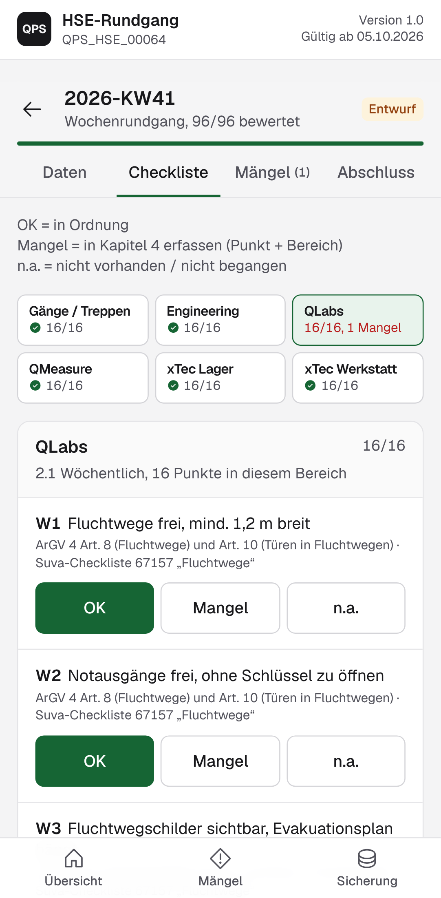
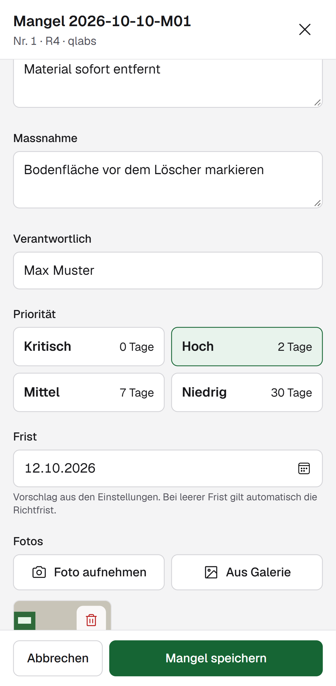
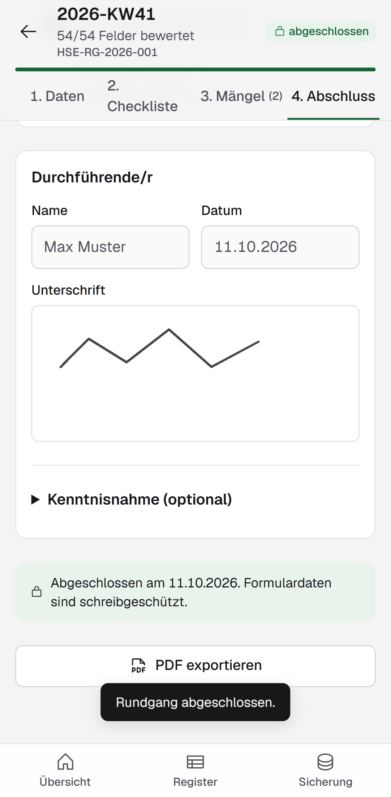

# HSE-Rundgang App (QPS_HSE_00064)

Mobile Web-App und Register für den **HSE Rundgang** der QPS Engineering AG, Stein (CH).
Sie bildet SOP **QPS_HSE_00064**, Version 1.0, gültig ab 05.10.2026, nach der aktuellen DOTX-Form und dem Excel-Register ab.
Das vorhandene DOCX im Ordner `docs/sop` enthält eine ältere Formularfassung. Word- und Excel-Quelldateien bleiben unverändert.

Der Rundgang wird direkt am Smartphone oder Tablet erfasst:

- **Kapitel 1 Rundgangdaten**: Datum, ISO-KW, Beginn/Ende mit berechneter Dauer, Durchgeführt von, Begleitperson, Monatspunkte 2.2 und offene Mängel des letzten Rundgangs.
- **Kapitel 2 Checkliste**: R1-R15 als Matrix mit den Spalten QPS, QLabs und xTec (45 Felder); optional M1-M9, wenn 2.2 geprüft wird. „Rest OK“ steht pro Bereich zur Verfügung.
- **Mängel und Massnahmen**: Mangel-ID JJJJ-MM-TT-Mnn, Punkt/Bereich, Beschreibung, Gefahr, Sofortmassnahme, Massnahme, Priorität, Frist und Kamerafotos direkt je Abteilung.
- **Kapitel 3 Abschluss**: vier Gesamtbewertungen sowie Unterschrift der durchführenden Person und optionale Kenntnisnahme. Formulardaten sind nach Abschluss schreibgeschützt.
- **Register als Excel-Ersatz**: Übersicht, Rundgänge und Mängel mit vier Statuswerten. Einstellungen übernehmen Richtfristen 0/2/7/30 Tage und Höchstintervall 14 Tage aus dem Excel-Blatt „Listen“.
- **Exporte**: PDF nach aktueller DOTX-Vorlage, XLSX mit Rundgänge und Mängel sowie JSON-Backup Formatversion 4.
- Periodische Geräte- und Wartungsprüfungen („Prüftermine“) werden bewusst nicht in der App geführt; dafür bleibt das separate Excel-Blatt zuständig.
- **Offline-fähig** (PWA, auf dem Startbildschirm installierbar). Daten liegen lokal im Browser (IndexedDB);
  Sicherung und Übertragung auf ein anderes Gerät per JSON-Datei unter "Sicherung".
- **Optionale KI-Fotoanalyse**: nur nach ausdrücklicher Aktivierung und Datenschutzzustimmung über einen separat betriebenen Cloudflare Worker. KI-Ausgaben sind unverbindliche Vorschläge; manuelle/offline Erfassung funktioniert unabhängig davon.

| Checkliste | Mangel mit Foto | Abschluss |
|---|---|---|
|  |  |  |

> Wichtig: Ohne Server liegen die Daten nur auf dem jeweiligen Gerät. Regelmässig unter "Sicherung" eine JSON-Datei
> auf das Firmenlaufwerk speichern. Der PDF-Bericht bleibt die prüffähige Ablage.

## Lokal starten

Voraussetzung: Node.js 22 oder neuer.

```bash
npm install
npm run dev          # http://localhost:5173 (im WLAN: npm run dev -- --host, dann am Handy die angezeigte IP öffnen)
```

Weitere Befehle:

```bash
npm run typecheck    # TypeScript prüfen
npm run worker:typecheck # Cloudflare Worker prüfen
npm test             # App-Unit-Tests
npm run test:worker  # Worker-Unit-Tests; Anthropic wird gemockt
npm run build        # Produktions-Build nach dist/
npm run preview      # Build lokal ansehen
npm run test:e2e     # Playwright-Tests (mobil, gemockter Worker inkl. Offline-Fall), erzeugt docs/screenshots/
```

Hinweis Kamera: Auf dem Handy funktioniert die Kamera-Aufnahme nur über **HTTPS** (oder localhost).
Für Tests im WLAN deshalb das deployte HTTPS-Ziel verwenden.

## Deployment (statisches Hosting)

Der Build in `dist/` ist eine reine statische Website und läuft auf jedem Webserver (GitHub Pages, IIS, nginx, Intranet-Share mit HTTPS).
Es wird ein Hash-Routing verwendet (`#/...`), es sind also keine Server-Rewrites nötig.

### GitHub Pages

1. Repository auf GitHub anlegen und `main` pushen.
2. In GitHub unter **Settings > Pages > Build and deployment** als Quelle **GitHub Actions** wählen.
3. Der Workflow `.github/workflows/pages.yml` prüft (Typecheck, Tests), baut mit `BASE_PATH=/<repo-name>/` und veröffentlicht.
   Die App ist dann unter `https://<benutzer-oder-org>.github.io/<repo-name>/` erreichbar.

`BASE_PATH` steuert Vites `base`. Ohne Angabe wird `./` verwendet; das funktioniert unter jedem Unterpfad.
Für eine eigene Domain im Stammverzeichnis: `BASE_PATH=/ npm run build`.

> Datenschutz: Ohne ausdrücklich aktivierte Fotoanalyse bleiben Rundgangsdaten und Fotos auf dem Gerät. Bei aktivierter Analyse wird nur das ausgewählte, verkleinerte Foto mit dem nötigen Kontext an den von der Organisation betriebenen Worker und Anthropic übermittelt. Der Worker speichert keine Bilder oder Inhalte. Anthropic verarbeitet API-Eingaben nach den aktuellen Vertrags-/Aufbewahrungsbedingungen und verwendet API-Eingaben standardmässig nicht zum Modelltraining. Siehe [Anthropic Commercial Terms](https://www.anthropic.com/legal/commercial-terms) und [Anthropic Privacy](https://privacy.anthropic.com/). KI-Vorschläge müssen immer fachlich geprüft werden.

## KI-Server einrichten

Die KI ist **standardmässig ausgeschaltet**. Ohne Einrichtung funktionieren Checkliste, Fotos, Mängelerfassung und PDF weiterhin manuell und offline. Der Anthropic-Schlüssel gehört ausschliesslich in den Cloudflare Worker — niemals in App-Einstellungen, `src/`, den Browser oder ein Git-Repository.

### Lokal testen

1. Node.js 22 oder neuer installieren. Im Repository-Ordner die App- und Worker-Abhängigkeiten installieren:

  ```bash
  npm install
  npm install --prefix server
  ```

2. Cloudflare-Konto unter [dash.cloudflare.com](https://dash.cloudflare.com/) erstellen. Im Terminal `cd server` ausführen und anmelden:

  ```bash
  npx wrangler login
  ```

3. `server/.dev.vars.example` als `server/.dev.vars` kopieren und die neue Datei lokal mit einem Texteditor öffnen. Platzhalter ersetzen:
  - `ANTHROPIC_API_KEY`: API-Schlüssel im Anthropic Console-Konto erstellen und nur hier einsetzen.
  - `CLAUDE_MODEL`: von der Organisation freigegebene Modellkennung.
  - `ACCESS_CODE`: langen zufälligen Zugangscode wählen und sicher an Nutzende weitergeben.
  - `ALLOWED_ORIGINS`: nur tatsächliche App-URLs aufführen (lokal `http://localhost:4173`, online `https://waldi-beck.github.io`). Keine Wildcards verwenden.

  **Wichtig:** `server/.dev.vars` ist in Git ignoriert. Deren Inhalt nie teilen, committen oder in die App eintragen.

4. Im `server`-Ordner den lokalen Worker starten:

  ```bash
  npx wrangler dev
  ```

5. In einem zweiten Terminal `npm run dev` starten. In der App **Einstellungen → KI-Fotoanalyse** öffnen, `http://localhost:8787` und den gleichen Zugangscode eintragen. Beim ersten Aktivieren den Datenschutzhinweis bestätigen. „Mit KI auswerten“ erscheint nur online und nach einem Foto.

6. Optional einen manuellen Test mit einem Beispielfoto starten. Dieser macht einen echten Anthropic-API-Aufruf und kann Kosten verursachen:

  ```bash
  npm run test:real -- ../tests/fixtures/mangel-fluchtweg.jpg
  ```

  Den Befehl im `server`-Ordner ausführen. Er liest den Schlüssel aus `server/.dev.vars`, gibt ihn nicht aus und wird nie von automatisierten Tests aufgerufen.

### Für andere Personen im Internet veröffentlichen

1. Im `server`-Ordner einmalig `npx wrangler login` ausführen.
2. Cloudflare fragt die drei Werte sicher interaktiv ab:

  ```bash
  npx wrangler secret put ANTHROPIC_API_KEY
  npx wrangler secret put ACCESS_CODE
  npx wrangler secret put CLAUDE_MODEL
  ```

  Den Anthropic-Schlüssel nie direkt in einen Befehl oder ein Repository schreiben.
3. In `server/wrangler.toml` unter `ALLOWED_ORIGINS` die exakte veröffentlichte App-Adresse eintragen. Danach aus `server` deployen:

  ```bash
  npx wrangler deploy
  ```

4. Die angezeigte HTTPS-Worker-Adresse in den App-Einstellungen eintragen und den `ACCESS_CODE` separat an Mitarbeitende weitergeben. Der API-Schlüssel wird **nicht** in der App eingetragen.
5. Das Cloudflare Durable Object zählt maximal 30 Analysen pro Zugangscode und UTC-Tag. Der Worker speichert nur den Zähler, keine Fotos, Prompts oder Bildinhalte.

Anthropic-Bedingungen: [Commercial Terms](https://www.anthropic.com/legal/commercial-terms) und [Privacy](https://privacy.anthropic.com/). Keine Fotos mit erkennbaren Personen oder vertraulichen Unterlagen zur KI senden.

## In Odoo verlinken

Die App wird nicht in Odoo eingebettet, sondern als Link geöffnet (Daten bleiben im Browser des Geräts).

- **Menüpunkt im Backend** (Odoo 16/17): Einstellungen > Technisch > Benutzeroberfläche > Menüpunkte > Neu.
  Name "HSE-Rundgang", übergeordnetes Menü z. B. "Lager" oder ein eigenes Menü,
  Aktion: neue Aktion vom Typ **"URL-Aktion" (ir.actions.act_url)** mit der App-URL und Ziel **"Neues Fenster"**.
- **Website / Intranet-Seite**: im Website-Editor eine Schaltfläche oder einen Link mit der App-URL einfügen.
- **Am Handy**: App-URL einmal öffnen und "Zum Home-Bildschirm" wählen. Danach startet sie wie eine App, auch offline.

Ein `iframe` ist nicht empfohlen: Kamera-Zugriff und Downloads sind in eingebetteten Frames je nach Browser eingeschränkt.

## SOP- und Registerdaten

Die Formularinhalte stehen in **`src/data/checklist.ts`** (fünf Formbereiche, Punkte R/M, Grundlagen, Formulartexte und Kopfdaten `SOP_META`). Workbook-Listen, Richtfristen, Status-/Ergebnisbeschriftungen und Prüfterminvorschläge stehen separat in **`src/data/register.ts`**.
Bei einer neuen SOP-Version:

1. `SOP_META.version` und `validFrom` anpassen, Punkte ändern (bestehende IDs nicht umnummerieren).
2. `npm test` ausführen (der Test prüft 15 × 5 + 9 Punkte sowie die Grundlagen je Kontrollpunkt).
3. Spezifikation unter `specs/001-hse-rundgang/` nachführen.

Jeder Rundgang speichert die SOP-Version, mit der er erstellt wurde. Änderungen der App: siehe `CHANGELOG.md`.

## Projektaufbau

```text
src/data/checklist.ts   DOTX-Formular und Checkliste
src/data/register.ts    Excel-Registerlisten, Voreinstellungen und Vorschläge
src/lib/                Fachlogik ohne UI: dates, walk, image, pdf, backup
src/db.ts               IndexedDB (Dexie)
server/                  separater Cloudflare Worker; Anthropic-Schlüssel nur serverseitig
src/components/, pages/ Oberfläche (React, Tailwind)
tests/unit, tests/e2e   Vitest, Playwright
specs/                  Spec-Kit-Features (001 HSE-Rundgang, 002 KI-Fotoanalyse)
.specify/               Spec Kit (Verfassung unter .specify/memory/constitution.md)
.claude/skills/         Spec-Kit-Skills und Taste-Skill (Gestaltungsregeln) für Claude Code
```

Technik: Vite, React, TypeScript, Tailwind CSS, Dexie (IndexedDB), jsPDF, vite-plugin-pwa, Phosphor Icons, Schrift Geist.

## Spec Kit und Taste-Skill

Die Anforderungen wurden mit [GitHub Spec Kit](https://github.com/github/spec-kit) erarbeitet
(`/speckit-specify`, `/speckit-plan`, `/speckit-tasks` usw. stehen in Claude Code als Skills bereit).
Die Gestaltung folgt dem [Taste-Skill](https://github.com/Leonxlnx/taste-skill) (MIT) mit den Einstellungen
VARIANCE 3 / MOTION 2 / DENSITY 5 für eine ruhige, gut lesbare Arbeits-App.

## Grenzen (v1)

- Keine Benutzerverwaltung, keine Synchronisation zwischen Geräten (nur Export/Import).
- Die Bildschirm-Unterschrift ist keine qualifizierte elektronische Signatur (ZertES).
- Prüftermine Quartal/Jahr bleiben im bisherigen Excel-Register.

Verantwortlich: HSE, Waldemar Becker.
