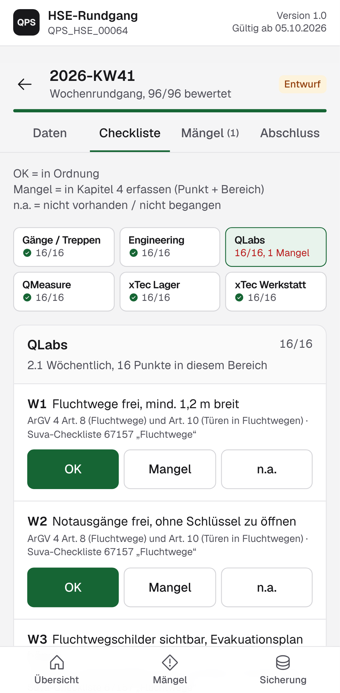
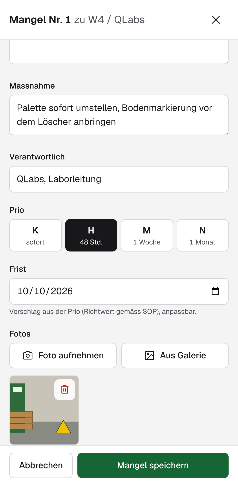
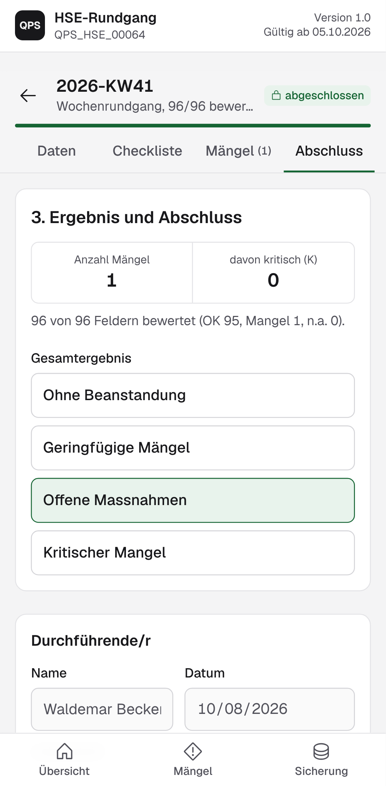

# HSE-Rundgang App (QPS_HSE_00064)

Mobile Web-App für den **wöchentlichen HSE-Rundgang** der QPS Engineering AG, Stein (CH).
Sie bildet die SOP **QPS_HSE_00064 "HSE Wöchentlicher Rundgang"**, Version 1.0, gültig ab 05.10.2026, ab
(`docs/sop/QPS_HSE_00064_HSE_Rundgang_V1.0.docx`).

Der Rundgang wird direkt am Smartphone oder Tablet erfasst:

- **Kapitel 1 Rundgangdaten**: Datum, Kalenderwoche (automatisch nach ISO 8601), Durchgeführt von, Uhrzeit, Begleitperson.
  Die App schlägt beim ersten Rundgang im Monat den **Monatsrundgang (2.1 + 2.2)** vor, sonst den **Wochenrundgang (2.1)**.
  Offene Mängel früherer Rundgänge erscheinen unter "Offene Punkte Vorwoche" und können dort nachkontrolliert werden.
- **Kapitel 2 Checkliste, Raum für Raum**: 2.1 Wöchentlich, W1 bis W16 je Bereich (Gänge / Treppen, Engineering, QLabs, QMeasure,
  xTec Lager, xTec Werkstatt, also 96 Felder); beim Monatsrundgang zusätzlich 2.2 Monatlich (M1 bis M9).
  Bewertung OK / Mangel / n.a. mit grossen Tasten, Rechtsgrundlage je Punkt, "Rest OK" je Bereich.
  "Mangel" öffnet direkt das Mängel-Formular mit Punkt und Bereich.
- **Kapitel 3 Ergebnis**: Anzahl Mängel, davon kritisch (K), Vorschlag für das Gesamtergebnis, Unterschrift am Bildschirm (Durchführende/r, optional Kenntnisnahme).
  Abschluss nur, wenn alles vollständig ist; danach schreibgeschützt.
- **Kapitel 4 Mängel und Massnahmen**: Nr. / Pkt. / Bereich, Mangel/Gefahr, Massnahme, Verantwortlich, Prio K/H/M/N mit automatischem Fristvorschlag
  (sofort / 48 Std. / 1 Woche / 1 Monat) und **Fotos direkt aus der Kamera** (werden auf 1600 px verkleinert).
- **Mängelregister**: alle Mängel über alle Rundgänge mit Punkt und Bereich, offen/erledigt, überfällige Fristen, CSV-Export für Excel.
- **PDF-Bericht** im Aufbau der Vorlage, inklusive Fotos und Unterschrift, Dateiname `HSE-Rundgang_JJJJ-KWxx.pdf` (SOP Kapitel 5).
- **Offline-fähig** (PWA, auf dem Startbildschirm installierbar). Daten liegen lokal im Browser (IndexedDB);
  Sicherung und Übertragung auf ein anderes Gerät per JSON-Datei unter "Sicherung".

| Checkliste | Mangel mit Foto | Abschluss |
|---|---|---|
|  |  |  |

> Wichtig: Ohne Server liegen die Daten nur auf dem jeweiligen Gerät. Regelmässig unter "Sicherung" eine JSON-Datei
> auf das Firmenlaufwerk speichern. Der PDF-Bericht bleibt die prüffähige Ablage.

## Lokal starten

Voraussetzung: Node.js 22 oder neuer.

```bash
npm install
npm run dev          # http://localhost:5173 (im WLAN: npm run dev -- --host, dann am Handy die angezeigte IP öffnen)
```

Weitere Befehle:

```bash
npm run typecheck    # TypeScript prüfen
npm test             # Unit-Tests (Vitest): KW, Prio -> Frist, Zähler, Ergebnis, Validierung, Checkliste, Sicherung
npm run build        # Produktions-Build nach dist/
npm run preview      # Build lokal ansehen
npm run test:e2e     # Playwright-Smoke-Test (mobiler Viewport), erzeugt docs/screenshots/
```

Hinweis Kamera: Auf dem Handy funktioniert die Kamera-Aufnahme nur über **HTTPS** (oder localhost).
Für Tests im WLAN deshalb das deployte HTTPS-Ziel verwenden.

## Deployment (statisches Hosting)

Der Build in `dist/` ist eine reine statische Website und läuft auf jedem Webserver (GitHub Pages, IIS, nginx, Intranet-Share mit HTTPS).
Es wird ein Hash-Routing verwendet (`#/...`), es sind also keine Server-Rewrites nötig.

### GitHub Pages

1. Repository auf GitHub anlegen und `main` pushen.
2. In GitHub unter **Settings > Pages > Build and deployment** als Quelle **GitHub Actions** wählen.
3. Der Workflow `.github/workflows/pages.yml` prüft (Typecheck, Tests), baut mit `BASE_PATH=/<repo-name>/` und veröffentlicht.
   Die App ist dann unter `https://<benutzer-oder-org>.github.io/<repo-name>/` erreichbar.

`BASE_PATH` steuert Vites `base`. Ohne Angabe wird `./` verwendet; das funktioniert unter jedem Unterpfad.
Für eine eigene Domain im Stammverzeichnis: `BASE_PATH=/ npm run build`.

> Datenschutz: Bei GitHub Pages ist nur der App-Code öffentlich (oder in einem privaten Repo mit Enterprise-Pages nur intern).
> Rundgangsdaten und Fotos verlassen das Gerät nie.

## In Odoo verlinken

Die App wird nicht in Odoo eingebettet, sondern als Link geöffnet (Daten bleiben im Browser des Geräts).

- **Menüpunkt im Backend** (Odoo 16/17): Einstellungen > Technisch > Benutzeroberfläche > Menüpunkte > Neu.
  Name "HSE-Rundgang", übergeordnetes Menü z. B. "Lager" oder ein eigenes Menü,
  Aktion: neue Aktion vom Typ **"URL-Aktion" (ir.actions.act_url)** mit der App-URL und Ziel **"Neues Fenster"**.
- **Website / Intranet-Seite**: im Website-Editor eine Schaltfläche oder einen Link mit der App-URL einfügen.
- **Am Handy**: App-URL einmal öffnen und "Zum Home-Bildschirm" wählen. Danach startet sie wie eine App, auch offline.

Ein `iframe` ist nicht empfohlen: Kamera-Zugriff und Downloads sind in eingebetteten Frames je nach Browser eingeschränkt.

## SOP-Änderungen

Die gesamte Checkliste steht in **`src/data/checklist.ts`** (Bereiche, Punkte W/M, Grundlagen je Kontrollpunkt, Formulartexte, Kopfdaten `SOP_META`).
Bei einer neuen SOP-Version:

1. `SOP_META.version` und `validFrom` anpassen, Punkte ändern (bestehende IDs nicht umnummerieren).
2. `npm test` ausführen (der Test prüft u. a. 16 × 6 + 9 Punkte und dass jeder Punkt genau einer Grundlage zugeordnet ist).
3. Spezifikation unter `specs/001-hse-rundgang/` nachführen.

Jeder Rundgang speichert die SOP-Version, mit der er erstellt wurde. Änderungen der App: siehe `CHANGELOG.md`.

## Projektaufbau

```text
src/data/checklist.ts   SOP-Definition (einzige Quelle)
src/lib/                Fachlogik ohne UI: dates, walk, image, pdf, backup
src/db.ts               IndexedDB (Dexie)
src/components/, pages/ Oberfläche (React, Tailwind)
tests/unit, tests/e2e   Vitest, Playwright
specs/001-hse-rundgang  Spec Kit: spec, plan, data-model, tasks
.specify/               Spec Kit (Verfassung unter .specify/memory/constitution.md)
.claude/skills/         Spec-Kit-Skills und Taste-Skill (Gestaltungsregeln) für Claude Code
```

Technik: Vite, React, TypeScript, Tailwind CSS, Dexie (IndexedDB), jsPDF, vite-plugin-pwa, Phosphor Icons, Schrift Geist.

## Spec Kit und Taste-Skill

Die Anforderungen wurden mit [GitHub Spec Kit](https://github.com/github/spec-kit) erarbeitet
(`/speckit-specify`, `/speckit-plan`, `/speckit-tasks` usw. stehen in Claude Code als Skills bereit).
Die Gestaltung folgt dem [Taste-Skill](https://github.com/Leonxlnx/taste-skill) (MIT) mit den Einstellungen
VARIANCE 3 / MOTION 2 / DENSITY 5 für eine ruhige, gut lesbare Arbeits-App.

## Grenzen (v1)

- Keine Benutzerverwaltung, keine Synchronisation zwischen Geräten (nur Export/Import).
- Die Bildschirm-Unterschrift ist keine qualifizierte elektronische Signatur (ZertES).
- Prüftermine Quartal/Jahr bleiben im bisherigen Excel-Register.

Verantwortlich: HSE, Waldemar Becker.
